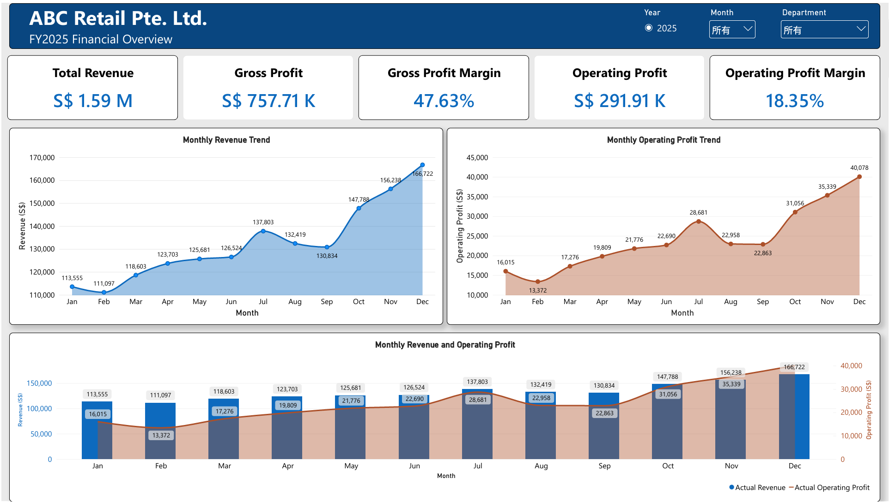

# ABC Retail Financial Performance & Budget Analysis Dashboard

An end-to-end financial analysis and business intelligence project using **Microsoft Excel, Power Query, Power BI, and DAX**.

> **Project Type:** Personal Project  
> **Company:** ABC Retail Pte. Ltd. (Simulated Company)  
> **Reporting Period:** FY2025 (Jan–Dec 2025)  
> **Currency:** SGD

---

## 1. Project Overview

This project develops an integrated financial analysis and business intelligence solution for ABC Retail Pte. Ltd., a simulated retail company.

It transforms raw financial data into actionable management insights through data cleaning, financial analysis, budget variance analysis, data modelling, and interactive Power BI dashboards.

The project evaluates overall financial performance, compares actual results against budget targets, and analyses profitability across different business departments.

 

## 2. Project Objectives

- Clean and validate financial datasets to ensure data accuracy and consistency.
- Develop monthly income statements and calculate key financial KPIs.
- Analyse budget versus actual performance and identify favourable and unfavourable variances.
- Evaluate financial performance across business departments.
- Build interactive Power BI dashboards to support financial reporting and decision-making.

## 3. Dataset Overview

The project uses simulated FY2025 financial data covering January to December 2025.

| Dataset Information | Details |
|---|---:|
| Actual Financial Records | 252 |
| Budget Records | 252 |
| Business Departments | 3 |
| Financial Categories | 7 |
| Reporting Period | Jan–Dec 2025 |

**Departments**
- Electronics
- Fashion
- Home & Living

**Financial Categories**
- Revenue
- COGS
- Salaries
- Rent
- Marketing Expense
- Utilities
- Other Operating Expense

## 4. Tools & Technologies

| Tool | Application |
|---|---|
| Microsoft Excel | Data cleaning, financial calculations, income statement preparation, and variance analysis |
| Power Query | Data transformation and preparation |
| Power BI | Data modelling and interactive dashboard development |
| DAX | Financial KPI calculations, budget comparisons, and variance measures |

## 5. Methodology

### 5.1 Data Cleaning & Validation — Excel

- Organised actual and budget datasets into structured tables.
- Checked for missing values, duplicate records, invalid dates, invalid amounts, and unmatched records.
- Created data quality checks and validation reports.
- Verified data consistency before financial analysis.

**Data Quality Result:** No missing records, duplicates, invalid categories, invalid amounts, invalid dates, or unmatched records were identified.

### 5.2 Financial Analysis — Excel

- Developed monthly income statements covering revenue, cost of goods sold, gross profit, operating expenses, and operating profit.
- Calculated key financial KPIs:
  - Gross Profit Margin
  - Operating Profit Margin
  - Revenue Growth Rate
  - Expense-to-Revenue Ratio
- Conducted budget versus actual analysis at monthly, departmental, and financial category levels.
- Evaluated financial variances in absolute and percentage terms.

### 5.3 Data Transformation & Modelling — Power Query and Power BI

- Imported and transformed actual and budget datasets using Power Query.
- Developed a dimensional data model with date, department, and category dimensions, alongside actual and budget fact tables.
- Established relationships between dimension and fact tables.
- Created DAX measures for financial KPIs, budget comparisons, and variance calculations.

### 5.4 Dashboard Development — Power BI

Developed three interactive dashboard pages:

| Dashboard | Key Analysis |
|---|---|
| **Financial Overview** | Revenue, gross profit, operating profit, profitability margins, and monthly financial trends |
| **Actual vs Budget Analysis** | Budget comparisons, monthly performance, category variances, and favourable/unfavourable variances |
| **Department Performance** | Department-level revenue, operating profit, profitability, margins, and budget performance |

Interactive filters allow users to explore financial performance across different departments and reporting periods.

## 6. Key Financial Findings

### 6.1 FY2025 Financial Performance

| Financial KPI | FY2025 Result |
|---|---:|
| Total Revenue | SGD 1,590,965.68 |
| Gross Profit | SGD 757,705.08 |
| Gross Profit Margin | 47.63% |
| Operating Profit | SGD 291,912.50 |
| Operating Profit Margin | 18.35% |

### 6.2 Budget Performance

- **Revenue:** Exceeded budget by SGD 45,245.68, representing a favourable variance of 2.93%.
- **Operating Profit:** Exceeded budget by SGD 17,293.92, representing a favourable variance of 6.30%.
- **Cost of Goods Sold:** Exceeded budget by SGD 37,453.00.
- **Operating Expenses:** Were SGD 9,501.24 below budget.

### 6.3 Department Performance

| Department | Actual Operating Profit |
|---|---:|
| Fashion | SGD 124,067.75 |
| Electronics | SGD 113,972.87 |
| Home & Living | SGD 53,871.88 |

**Key Observations:**
- Fashion recorded the highest operating profit.
- All three departments achieved operating profit above their respective budget targets.
- Home & Living recorded the highest operating profit budget variance percentage at approximately 10.60%.

## 7. Skills Demonstrated

- **Financial Analysis:** Income statement analysis, profitability analysis, budget monitoring, and departmental performance evaluation.
- **Excel:** Data cleaning, SUMIFS, financial calculations, and variance analysis.
- **Power Query:** Data transformation and preparation.
- **Power BI:** Data modelling, interactive dashboards, and data visualisation.
- **DAX:** Financial KPI calculations, measures, and budget variance analysis.

## 8. Project Limitations & Future Improvements

This project uses simulated financial data rather than actual company financial statements. The analysis covers a single financial year and does not incorporate external market conditions or operational drivers.

Potential improvements include:

- Expanding the analysis to multiple financial years.
- Developing rolling forecasts and budget forecasting models.
- Incorporating additional operational KPIs.
- Automating data refresh and financial reporting processes.

---

**Project Status: Completed**

*This project was developed for educational and portfolio purposes using simulated financial data.*
